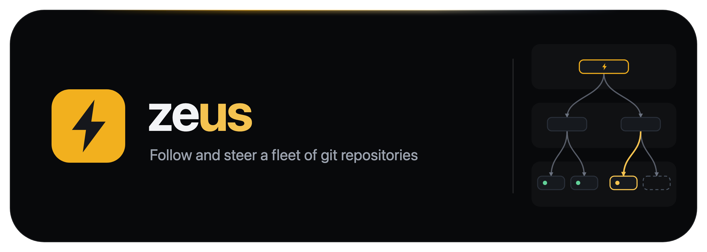
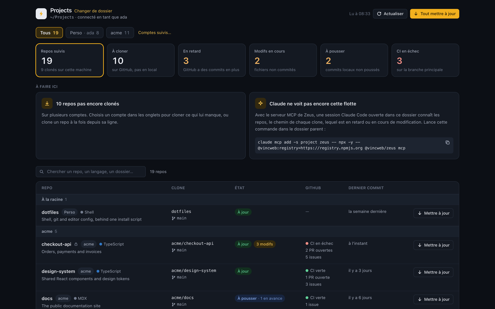
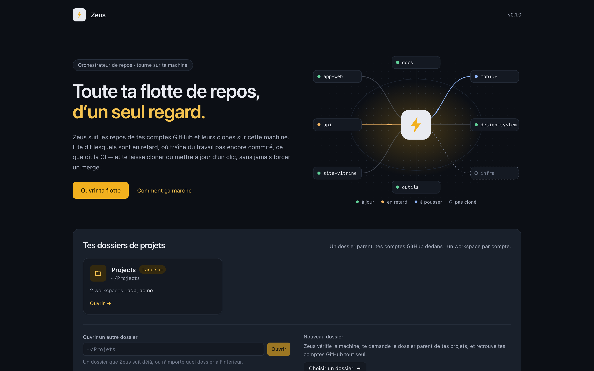
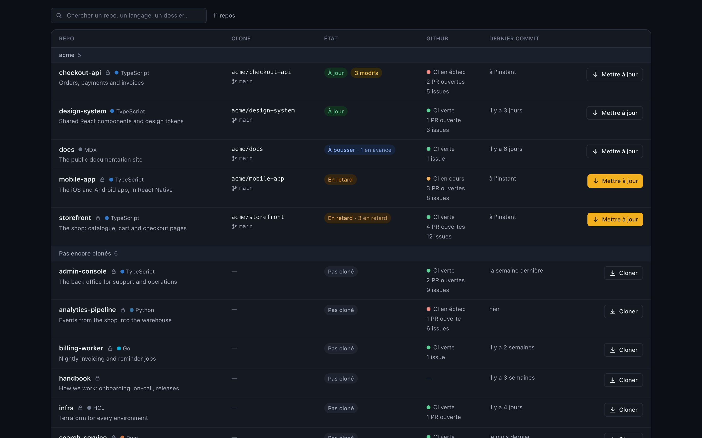
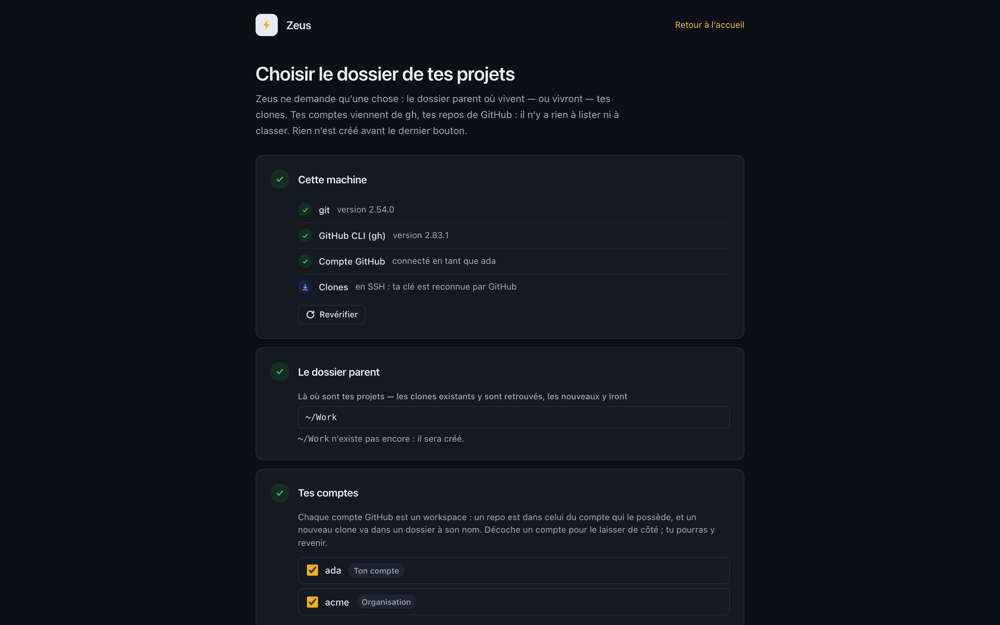
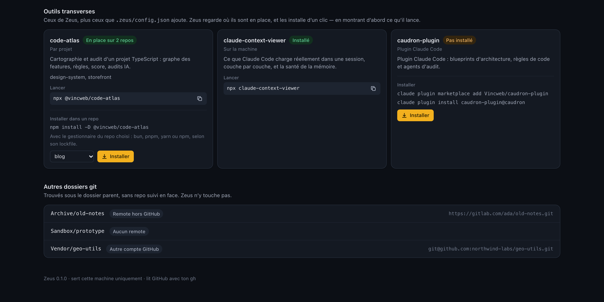

<div align="center">



**Follow and steer a fleet of git repositories.**

The repositories of your GitHub accounts and their clones on this machine: which are behind,
where uncommitted work is lying around, what CI says. Clone and update in one click, install the
tools your projects share — and hand the whole picture to Claude Code as an MCP server.

[](https://www.npmjs.com/package/@vincweb/zeus)
[](https://github.com/Vincweb/zeus/releases/latest)
[](https://github.com/Vincweb/zeus/actions/workflows/ci.yml)
[](package.json)
[](package.json)
[](LICENSE)

</div>

<br>

<div align="center">

</div>

<div align="center"><sup>Every picture here is taken against an invented fleet.</sup></div>

<br>

```sh
npx @vincweb/zeus            # open the page on your fleet
npx @vincweb/zeus status     # the same state, as a table in the terminal
```

## Why

git guards a repository. Nothing guards the thirty you have: the ones on your own account and the
ones of each organization you belong to, some cloned here, some never, a few weeks behind, one
holding work you forgot to commit. On a new machine it all starts over, from memory.

Zeus asks for one thing — **the parent folder** of your projects — and reads everything else where
it lives: your accounts from `gh`, your repositories from GitHub, your clones from a scan of that
folder. There is nothing to list and nothing to sort, so there is nothing to keep in step.

The page and the command line speak French for now.

## Install

```sh
npx @vincweb/zeus                  # run it once
npm install -g @vincweb/zeus       # or keep the `zeus` command around
```

It needs Node 20 or newer, `git`, and [`gh`](https://cli.github.com) signed in to your account
(`gh auth login`). No runtime dependency. It serves `http://127.0.0.1:4900` and opens it in your
browser: on your fleet when started in a followed folder or anywhere beneath it, otherwise on a
welcome page that takes you through choosing one. Zeus keeps no token: it sees exactly what your
`gh` login may see.

An npm scope has one registry per machine. Where `~/.npmrc` sends `@vincweb` somewhere other than
npm — to GitHub Packages, for private packages — the command above answers 404, and the registry
has to be named:

```sh
npx --@vincweb:registry=https://registry.npmjs.org @vincweb/zeus
```

| Command                               | What it does                                                |
| ------------------------------------- | ----------------------------------------------------------- |
| `zeus`                                | opens the page: on your fleet, otherwise on the welcome     |
| `zeus init [dir]`                     | makes a folder the parent folder (`.zeus/`)                 |
| `zeus status [--workspace <account>]` | the state of every repository, as a table                   |
| `zeus status --json [--full]`         | the same as one document — for a script or an agent         |
| `zeus clone <repo> [--into <dir>]`    | clones a followed repository, in the folder of its account  |
| `zeus update <repo>…` / `--all`       | fetch, then fast-forward wherever nothing stands in the way |
| `zeus install <tool> [--repo <repo>]` | installs a cross-project tool                               |
| `zeus mcp`                            | serves the fleet to an agent (MCP, on stdio)                |

| Option             | Default                                       | What it does                                                         |
| ------------------ | --------------------------------------------- | -------------------------------------------------------------------- |
| `-r, --root <dir>` | `ZEUS_ROOT`, else the folder holding `.zeus/` | the parent folder                                                    |
| `-p, --port <n>`   | `4900`, or the next free one                  | the page's port                                                      |
| `--host <host>`    | `127.0.0.1`                                   | the interface to listen on                                           |
| `--no-open`        |                                               | do not open the browser                                              |
| `--full`           |                                               | with `status`: also wait for the CI and pull requests of a large org |

## The model: one parent folder, nothing to sort

| What                        | Where it comes from                                                                                             |
| --------------------------- | --------------------------------------------------------------------------------------------------------------- |
| your **workspaces**         | `gh`: your account, and every organization you belong to                                                        |
| the **repositories** of one | GitHub: the ones that account owns                                                                              |
| the **clones**              | a scan of the parent folder, each clone matched to its repository by its `origin` remote — never by folder name |
| where a **new clone** goes  | `<parent folder>/<account>/<repo>`: GitHub's own organization, mirrored on disk                                 |

So there is no second organization to keep aligned with the first: a repository of `acme` is in
the `acme` workspace, and if it is in the wrong place, that is fixed on GitHub. Existing clones do
not move — Zeus finds them wherever they are under the parent folder.

### `.zeus/`

`zeus init` (or the page, the first time) puts a `.zeus/` folder at the root of the parent folder.
It **marks** the root: started in any folder beneath it, Zeus walks up to it, the way git walks up
to `.git`. No path is written anywhere, so the same folder works as it is on another machine.

It can stay empty. `.zeus/config.json`, optional, holds only what nobody else can know:

```json
{
  "hiddenOwners": ["a-very-large-org"],
  "followedRepos": { "another-org": ["the-one-project"] },
  "folders": { "ada": "perso" },
  "tools": [
    {
      "id": "my-tool",
      "scope": "repo",
      "run": "npx my-tool",
      "install": { "kind": "dev-dependency", "package": "my-tool" },
      "detect": { "dependency": "my-tool" }
    }
  ]
}
```

- **hiddenOwners** — accounts `gh` sees and this folder leaves out. Also set from the page
  (« Comptes suivis… »).
- **followedRepos** — for an account whose repositories are not all followed, the ones that are.
  An account not named here is followed whole, repositories to come included. Also set from the
  page (« Repos suivis… »).
- **folders** — the folder new clones of an account go to, when it is not the account's name.
- **tools** — cross-project tools on top of the default ones (Claude Code, code-atlas,
  claude-context-viewer); a tool that reuses the `id` of a default one replaces it.
- **scanDepth** (3), **includeArchived** (`false`).

## The page

<div align="center">

</div>

- **Welcome** — what Zeus is, the folders already followed, and how to install it elsewhere.
  Started in a followed folder, or beneath one, Zeus opens its fleet directly.
- **Choosing a folder** — for a machine that has never seen Zeus: `git`, `gh`, the account signed
  in, how clones are fetched; then the parent folder; then the accounts found. Zeus observes and
  says what to run (`gh auth login`): it signs nobody in.
- **The fleet** — in the header, Zeus's terminal and a window on driving the fleet from Claude;
  then one tab per workspace, six figures that filter, the tools folded beneath them, and the table
  of repositories grouped by folder — with « Tout mettre à jour » above it, and a code-atlas column
  where it is set up. At the end, two folded lists: the other git folders found under the root —
  without a remote, outside GitHub, from another account, not followed, no longer listed by GitHub —
  each with its reason, and the archived repositories that are not cloned.

<div align="center">

</div>

<br>

<div align="center">

</div>

A large account is listed at once and detailed afterwards: the CI and pull requests of its
repositories that are not cloned arrive a few seconds later, without holding the page.

## Cross-project tools

<div align="center">

</div>

Zeus lists the tools that serve several projects, says where each is in place, and installs it in
one click. A tool has a `scope` and, for the click, an `install` recipe:

| Recipe                                                                                   | What a click runs                                                                                                | Where       |
| ---------------------------------------------------------------------------------------- | ---------------------------------------------------------------------------------------------------------------- | ----------- |
| `{ "kind": "claude-plugin", "plugin": "name@marketplace", "marketplace": "owner/repo" }` | `claude plugin marketplace add …` then `claude plugin install …`                                                 | Claude Code |
| `{ "kind": "npm-global", "package": "name", "from": "npmjs" }`                           | `npm install -g name` — with `"from": "npmjs"`, from the public registry whatever `~/.npmrc` maps the scope to   | the machine |
| `{ "kind": "dev-dependency", "package": "name" }`                                        | the development dependency, added with the package manager **of the chosen repository** — bun, pnpm, yarn or npm | one clone   |
| `{ "kind": "claude-code" }`                                                              | nothing: its installer is shown to copy — `claude update` brings it up to date                                   | the machine |

`"from": "npmjs"` is for a package published on the public registry while `~/.npmrc` sends its
scope elsewhere — a scope often points at a private registry for other packages; the option holds
for that one command, and nothing is written. Zeus's own tools are declared so.

A recipe only names a package or a plugin, never a command: the forms are fixed, and a name
that is not just a name (`--registry=…`, `a; b`) is refused when the config is read. The page shows
the commands before running them, then what each one answered.

In a clone, the installation is refused when it has modified files — so that the addition stays
readable — and leaves `package.json` and the lockfile modified, to commit in that repository. An
`install` written as a plain string stays a command to copy.

Detection (`detect`): `files` or `dependency` in a clone, `plugin` among the plugins Claude Code
has installed, `command` on the `PATH`.

**« Lancer »** starts the tool under Zeus — the `detect.command` of a machine-wide tool, in the
parent folder; `npx <package>` for a project's tool, in a clone that depends on it — and Zeus's
terminal (a button at the top of the page, a window that comes up from the bottom) shows what it
prints, opens the page it serves, and stops it. On macOS, the terminal icon opens it in Terminal
instead. Claude Code is not launched from its card: « Piloter avec Claude » opens a session in the
app. The line comes from the recipe — a `run` written in the config is only shown, to copy. Tools
started from the page stop with Zeus.

The terminal also keeps what the server itself did: its own lines, and each clone, update or
installation with the commands it ran and what they answered. It lives in the server's memory; what
is over can be closed.

Where code-atlas is set up, the list of repositories shows the score it **recorded** — its baseline,
`.code-atlas/baseline.json`, accepted on a given day — not a measure taken now. While code-atlas
runs under Zeus (« Lancer » on its card), that score is a link: it opens the clone in code-atlas's
page, at the address code-atlas announced.

For the tools of the machine and of Claude Code, Zeus also says whether a **later release** exists
— npm for a package, the marketplace's catalog on GitHub for a plugin — and updates them on a
click (`npm install -g name@latest`, `claude plugin update …`). A project's tool is left out: its
version is one of that project's dependencies.

## What Zeus does — and does not

Zeus is an **orchestrator**. The rule that draws the line:

> What can be computed by looking at **one repository** belongs to that repository's own tool
> ([code-atlas](https://github.com/Vincweb/code-atlas) for a TypeScript project).
> What takes **several repositories**, or is not about the code, belongs to Zeus.

So Zeus knows which repositories exist, where their clones are, whether they are behind, what CI
says, which tools are in place. It reads neither lockfiles nor code: a score, outdated
dependencies, an audit — code-atlas computes them, and Zeus gathers them.

## Working with Claude Code

Zeus plugs into Claude Code as an MCP server: a session opened **on the parent folder** then knows
the fleet, instead of rebuilding it with `git` and `gh`.

```sh
claude mcp add -s project zeus -- npx -y --@vincweb:registry=https://registry.npmjs.org @vincweb/zeus mcp
```

The registry is named on purpose: the command then works on any machine, whatever its `~/.npmrc`.
`-s project` writes `.mcp.json` in the parent folder. The page gives the exact command until that
is done, and Claude Code asks for your agreement the first time.

| Tool      | What it answers                                                                                                                                                                                             |
| --------- | ----------------------------------------------------------------------------------------------------------------------------------------------------------------------------------------------------------- |
| `fleet`   | the followed repositories, one line each: workspace, path of the clone, state, changes in progress, CI, ready or not — per account (`workspace`) and filtered (`attention`, `behind`, `dirty`, `to-clone`…) |
| `repo`    | one repository in full, and why its clone is not ready when it is not                                                                                                                                       |
| `home`    | the workspaces, where their new clones go, the tools in place, the other git folders                                                                                                                        |
| `update`  | fetch then fast-forward — writes to disk                                                                                                                                                                    |
| `clone`   | clones a repository in the folder of its account — writes to disk                                                                                                                                           |
| `install` | installs a cross-project tool, in Claude Code, on the machine or in a clone — writes to disk                                                                                                                |

The split: **Zeus says where and in what state**, Claude Code **opens the conversations**. The
session of the parent folder is the orchestrator; to work in a repository it opens a session on
the `path` Zeus gives it, which then loads that repository's `CLAUDE.md` and tools. Zeus starts no
agent itself.

The `.mcp.json` of the parent folder is seen from its sub-folders too: `claude mcp list`, run in a
project, lists the `zeus` server of the folder above. The command it declares must therefore work
from anywhere — an absolute path, or `npx` — and `zeus mcp` finds the root by walking up.

Do not put an orchestration `CLAUDE.md` at the root of the parent folder: it would be loaded in
the sessions of every project beneath it. A skill in `.claude/skills/` has no such flaw.

## Updating, without surprises

Updating runs `git fetch --prune`, then a fast-forward to the branch being followed — and only a
fast-forward. Never a merge, a rebase or a stash:

| The clone                         | What happens                          |
| --------------------------------- | ------------------------------------- |
| clean, behind                     | moved up to the remote branch         |
| tracked files modified            | fetched, the branch left where it was |
| local commits **and** remote ones | fetched, reported as diverged         |
| a branch that follows nothing     | fetched, nothing else                 |

Untracked files do not stand in the way: git itself refuses the fast-forward if they were about to
be overwritten.

Clones are fetched over SSH when GitHub knows a key on the machine, over HTTPS otherwise — git
then borrows the login of `gh`. It is a fact of the machine: it is observed, and written in no
config.

## Security

The page can run `git clone` and `git fetch`: it obeys only itself.

- The server listens on `127.0.0.1` and answers only to `localhost` (no DNS rebinding).
- An action is a `POST` of JSON, refused to any origin but the page.
- An action receives only an `owner/name` identifier: the URL and the path come from what the
  server itself read on GitHub and on disk. The destination of a clone is the folder of the
  account, an existing folder, or a few plain names checked one by one — always under the root.
- Leaving out or following an account only names accounts your `gh` listed.
- No shell, no prompt: a command that would ask for a password fails instead of waiting.
- Installing a tool names a tool and, at most, a repository: what runs is the recipe the server
  holds for that tool, in a clone it found itself.
- A tool started from the page runs without a shell or a stdin, in a process group of its own that
  is stopped with the server.
- The one exception to « no shell »: opening a tool in Terminal, in plain sight, on a line built
  from that same recipe; the folder and the words reach it as arguments, quoted by macOS.
- Zeus keeps no token, creates no repository and pushes nothing.

## Development

```sh
pnpm install
pnpm dev --root ..     # API on :4900 with reload, page on :4901
pnpm check             # lint, types, tests, build
pnpm readme:images     # regenerate docs/media from the invented fleet (needs Chrome)
```

The same skeleton as [claude-context-viewer](https://github.com/Vincweb/claude-context-viewer)
and [code-atlas](https://github.com/Vincweb/code-atlas): Node's own `http` server without a
dependency, a React + Vite + Tailwind page, `tsup` for the CLI, `node:test` for the tests.

The pictures come from `scripts/readme-images.ts`: the built Zeus, run for real in a throwaway
home over real git clones, with a stand-in for `gh` that answers from `scripts/demo-fleet.ts` —
no account or repository of that fleet is real, and nothing reaches GitHub.

### Publishing

A `v*` tag starts `.github/workflows/release.yml`, which checks, packs, creates the GitHub Release
with the tarball, then publishes to npm without a token (trusted publishing). The tarball attached
to each release also runs without a registry: `npx <URL of the tarball>`.

The package keeps the name `@vincweb/zeus`, on public npm. As that scope also serves private
packages on GitHub Packages, `publishConfig` pins the registry of the scope: without it,
`npm publish` and `pnpm publish` would send Zeus to the registry `~/.npmrc` gives `@vincweb`.

To release: raise `version` in `package.json`, then push the tag `v<version>`.

0.1.0 was published by hand; from 0.1.1 on, tags publish on their own. Trusted publishing is
declared on npmjs.com, in the package settings, for user `Vincweb`, repository `zeus` and workflow
`release.yml`, with `npm publish` allowed — renaming any of the three breaks it. Without that
permission, npm only accepts `npm stage publish` from the workflow, each version then waiting for
an approval.

To publish by hand: `npm login` — without `--scope`, which would rewrite the registry of
`@vincweb` in `~/.npmrc` — then `npm publish`. The workflow points the pictures of this README at
the tag's raw files before packing, since a package page does not resolve relative paths; a
publication by hand has to do the same first, or the page shows no picture.

## Next

- run `code-atlas --check --format json` on each repository and show the scores;
- the services around the repositories: deployments, quotas;
- a « ready to change machines » report: what is not on GitHub yet.

## License

MIT
